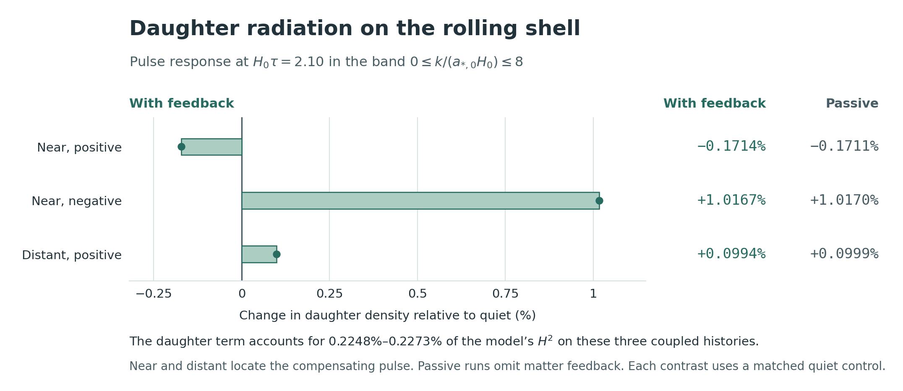
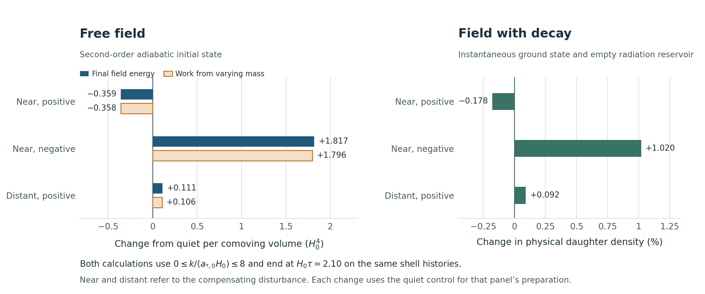

# What supplies the radiation on the rolling B1 shell?

A simulated incoming scalar pulse changes how much energy a rolling shell transfers to quantum matter and then to radiation. In this calculation the field's density, pressure and force act back on the five-dimensional shell as it evolves. A positive front can raise or lower the final radiation density even when the first mass crossing is identical. The difference depends on the later arrival of the compensating part of the initial disturbance. [Study plan posted before the calculations](https://github.com/maldonado-research/HDblast/issues/157#issuecomment-6994917788) · [Zenodo edition](https://doi.org/10.5281/zenodo.24355836)

### How large is the effect?

Start one real, minimally coupled quantum scalar in its specified ground state on the common rolling background and the modeled massless daughter reservoir empty. Its mass is $m/H_0=100|\phi-0.5|$. Compare four simulations at the same proper time, $H_0\tau=2.10$. All use the same initial rolling displacement and finite momentum band $0\le k/(a_{*,0}H_0)\le8$, with $a_{*,0}$ the historical quiet crossing scale factor. The quiet rolling solution crosses the massless point and produces radiation even in the absence of an extra pulse.

| Incoming disturbance | Daughter density in units of $H_0^4$ | Change from quiet | Daughter term as a share of $H^2$ |
|---|---:|---:|---:|
| Quiet rolling control | 37.1576 | — | 0.2251% |
| Positive front, nearby compensator | 37.0939 | −0.1714% | 0.2248% |
| Negative front, nearby compensator | 37.5354 | +1.0167% | 0.2273% |
| Positive front, distant compensator | 37.1945 | +0.0994% | 0.2254% |

The two positive fronts reach the original mass crossing at the same $H_0\tau=1.485455$ to the quoted precision. The distant compensator is outside the causal past of the final measurement. In the native Friedmann balance, moving the small mixed matter–radiation term into the radiation column changes the quiet share from 0.22512% to 0.22514%. None of these four simulations enters radiation domination in the recorded interval. The share of $H^2$ describes this model's expansion and its chosen finite band. It is not an estimate of the radiation density parameter of our Universe. [Coupled equations, controls and units](coupled/COUPLED.md)

Widening the momentum band changes the absolute radiation yield appreciably. This follow-up used 32 momentum nodes and repeated all four disturbances on both bulk meshes at each larger cutoff. In the fine-grid quiet runs the daughter density rose from 37.16 at the nominal cutoff of 8 to 56.07 at 12 and 59.75 at 14. The corresponding expansion shares were 0.225%, 0.339% and 0.361%. At cutoff 14 the pulse-induced changes were −0.283% (near positive), +1.527% (near negative) and +0.117% (distant positive). All three signs survived widening. The yield has a measurable cutoff dependence, and these calculations give no continuum limit. [Momentum-band comparison and validity screen](coupled/bands/BANDS.md)

### Where does the energy come from?

The scalar field on the shell changes the mass of the quantum field. This supplies work through $\tfrac12 (d m^2/d\tau)\langle\chi^2\rangle$. We use the same finite-band ground-state subtraction in energy, pressure and scalar force. For normalized comoving volume $a^3$, let $W$ denote integrated scalar work and $P_{\rm exp}$ denote integrated pressure work done by matter and radiation during expansion. The energy identity tested from the empty initial state is

$$a^3(\rho_\chi+\rho_r)= W-P_{\rm exp}.$$

In the coupled quiet run $W=157.1069$ and $P_{\rm exp}=2.9957$ in comoving $H_0^4$ units. For the nearby positive, nearby negative and distant positive histories $W=156.8069,158.6260,157.2003$. The maximum normalized energy-balance residual across the primary runs is below $4.2\times10^{-9}$. Running the matter passively, with its source removed from the bulk and wall conditions, gives a quiet daughter density of 37.2477, compared with 37.1576 with reciprocal coupling. This switch measures the influence of matter on the entire evolution from preparation to readout. A separate Gaussian solver reproduced all 32 published wall histories, and a 48-state test checked the pressure, scalar force and conversion to junction units. [Independent numerical tests](review/REVIEW.md)

**Does the shell receive net energy from the bulk over this interval?** An independent flux measurement uses the scalar field at five radial points strictly inside the simulated bulk. It estimates the normal derivative at the shell without inserting the junction condition. Between the pulse launch slice $T=1.11$ and the same final readout, the quiet reference has two-sided scalar flux **−0.95323**, with positive defined into the shell. In the same normalized junction units, changing surface tension contributes **−0.95336**, while matter receives **+0.00012995** in scalar work. The integrated flux is outward over that window. Measuring a positive radiation density on the shell therefore does not imply net incoming scalar energy over this window. Subtracting the large tension term from the interior flux also recovers the sign of the much smaller change in matter work for all three pulses. Sampling every native time step matters for this cancellation. [Independent bulk-side flux and resolution checks](interface/INTERFACE.md)

A separate calculation on the previous release's fixed backgrounds uses a stable free field with the same adiabatic preparation as that release. Explicit mass work accounts for 95.75%–99.55% of the three pulse-induced changes in total field energy at the final cut. For the nearby positive pulse, $-0.35753$ in scalar work and $-0.00161$ in expansion work account for $-0.35914$ in field energy. The attribution to source and pressure is given with its subtraction convention. It does not identify the net energy carried by an isolated cosmological blast. [Free-field work balance](ledger/LEDGER.md) · [Independent decay calculation on imposed walls](decay/DECAY.md)

### Why counting particles at one instant is insufficient

- A response function calculated from the *quiet* waves predicts all four pulse-induced changes in the final free-field count to within 0.33% of each change on both mesh resolutions. A controlled test places two equal positive mass perturbations at different times after the crossing. One increases the final count by 0.229%. The other decreases it by 0.156%. [Retarded response derivation, controls and data](kernel/KERNEL.md)
- On the same nearby positive wall at $H_0\tau=1.55$, two states can have identical energy and identical occupation in every mode. Rotating the quantum phase of each mode changes the subsequent scalar work from 342.52 to 211.04 in comoving $H_0^4$ units. Allowing all the tested pure Gaussian phases yields a work range of 178.84–374.71 on the declared quadrature. A common state-independent subtraction leaves the width of that range unchanged. [Phase experiment and bounds](subtraction/PHASE_WORK.md)

### Physical scope

The quantum evolution replaces the original fitted event rule on this band. The new inputs are a finite comoving momentum window, an instantaneous physical-oscillator ground subtraction, a specified initial state and a memoryless quantum decay channel. A massless daughter fluid receives the energy lost in that channel and redshifts with pressure $\rho_r/3$. Its thermalization and particle distribution are unspecified. The shell already rolls before the incoming packet is added. These calculations test source work and feedback in that effective model. A higher-dimensional origin for the Big Bang would additionally require a physical source, an energetic route to a hot radiation-dominated epoch and an observational discriminator. [Primary literature including the November 2026 revision](literature/SOURCES.md) · [Earlier project results and portfolio audit](portfolio/PORTFOLIO.md)

### Reproduce the results

Extract the two Zenodo ZIPs into the same directory, or work in the HDblast repository. From this study directory run the following. The default checks use the Python standard library. The full numerical replay uses Python 3.12, NumPy 2.3.5 and SciPy 1.17.0.

~~~sh
python -I -B reproduce.py
OPENBLAS_NUM_THREADS=1 python -I -B reproduce.py --full
~~~

The coupled study includes its native solver entry point and launches ordinary B1 bulk integration from authenticated historical equations. The figures can be redrawn with Matplotlib. [Native simulation reproduction](coupled/COUPLED.md) · [Historical file hashes](SOURCES.json) · [Previous study](https://doi.org/10.5281/zenodo.24355584)
