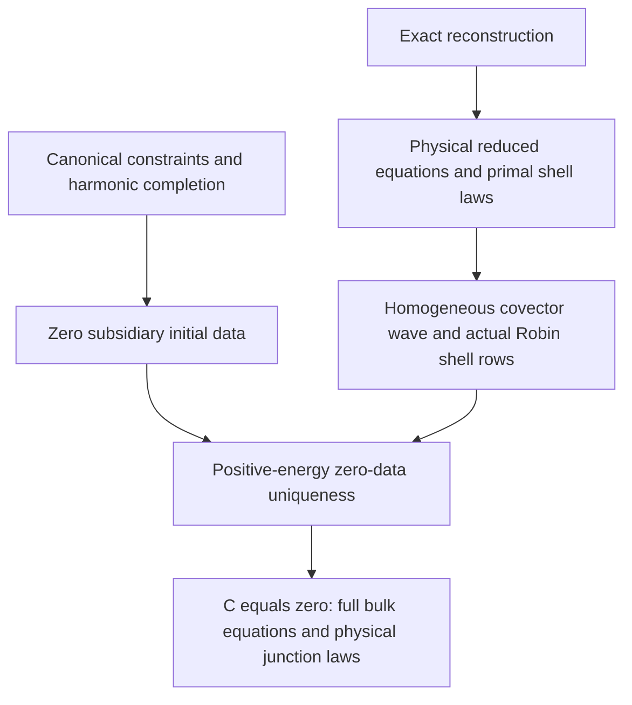

# Conditional full Einstein–scalar/Israel local solution

16 November 2026 UTC. This checkpoint continues the actual
[reduced nonlinear solution](../HDBLAST_NONLINEAR_PICARD_LIMIT_20261114/README.md)
at immutable base `6ee27c36dac67497a2454f7c1283fd7177a91888`.

The reconstructed solution now satisfies the full retained bulk
Einstein–scalar equations and physical Israel/scalar shell laws.
The exact initial constraints and gauge completion give zero subsidiary
data. Bianchi and Codazzi give the actual homogeneous covector wave and
mixed Dirichlet/Robin boundary rows. A finite-regularity positive-energy
argument then keeps the relative harmonic vector identically zero.

This is a conditional local mathematical result under the retained
background/enclosure, coefficient-chart, selected canonical-family and
smooth frozen-linear construction premises. It does not establish a
higher-dimensional origin of the Big Bang or a measured signal.

## The resulting local solution

In the retained original past interval `-T<=t<=0`, on
`[0,6ell] x S3`, with `ell=10^-6` and `T=13ell/8`, the physical fields obey

```
Ric_AB-phi_A phi_B-(2/3)mathcalU(phi)g_AB=0,
Box_g phi-mathcalU'(phi)=0,
C^A=g^BC(Gamma[g]^A_BC-Gamma[g0]^A_BC)=0.
```

At the shell, using the actual outward proper-y normal,

```
g_ya=0, K_ab=sigma(phi)h_ab/6, n_out(phi)=-sigma'(phi)/2.
```

The fixed actual potential, tension and background conventions are
retained. The reconstruction keeps the full reference connection and
its derivatives, radial component root, constant shell scales, moving
frame and tensor time-slot reflection. It reconstructs the same original
parameter member, including all mixed initial velocities.

For every fixed selected canonical `abs(epsilon)<=a_iter`,

```
a_iter=10^(-10^500209), Dbar=10^4200 a_iter,
d=||p||H14+||q||H13<=Dbar,
partial_t^j(g,phi) in C([-T,0];H^(14-j)),  j=0,...,14.
```

This positive nested ceiling remains an extremely conservative sufficient
mathematical threshold. It has no measured cosmological amplitude
calibration. No additional smallness restriction or shortened slab is
introduced by the subsidiary uniqueness argument.

The normalized perturbation retains its previous evaluated X14 bound
and outer zero collar `80ell/19<z<=6ell`. The smooth inverse point map
reconstructs the exact background there, closing the actual outer
subsidiary problem. This is not an imposed new outer physical source.

Uniqueness is in the retained relative-harmonic class whose inverse
straightened state belongs to C X14 with `sup_s X14<R`, `R=10^-12`,
with the same data, shell mixed rows and homogeneous outer Dirichlet
row. Pointwise chart membership alone is insufficient for that
uniqueness statement. No uniqueness across arbitrary gauges is proved.

The prescribed Gamma=(Z2)^4 invariant class retains all allowed angular
modes without an angular cutoff. The identical two-copy version uses
the declared outward normals and original global norm convention.
No new copy factor, independent force law or tension-energy calibration
is inferred.

## Four proof joins

1. [Exact physical reconstruction and boundary equivalence](PHYSICAL_RECONSTRUCTION_AND_BOUNDARY_JOIN.md)
   reverses the complete normalized/product/coordinate equation and point
   chart, then passes the physical shell laws at the available regularity.
2. [Exact initial subsidiary data](INITIAL_SUBSIDIARY_DATA_JOIN.md)
   uses the current half-action canonical momenta, exact constraints,
   all five harmonic completion equations and actual reduced J2.
3. [Finite-regularity covector energy uniqueness](SUBSIDIARY_ENERGY_UNIQUENESS.md)
   handles the actual coupled five-covector wave with arbitrary-sign
   Robin coefficient and all conjugation derivatives.
4. [Integrated unreduced local theorem](UNREDUCED_LOCAL_SHELL_SOLUTION.md)
   supplies Bianchi/Codazzi, checks all companion hypotheses and states
   the precise physical and uniqueness scope.



The tangential subsidiary row is
`partial_y C_a-(N sigma/3)C_a=0`; replacing it by ordinary homogeneous
Neumann, or halving its coefficient, loses the covector-connection
contribution. The temporal ADM lapse and radial component root remain
distinct. Qualitative finite energy constants suffice for zero-data
uniqueness; no new evaluated physical/subsidiary coefficient ceiling
has been inserted into the numerical amplitude ledger.

## Reproducibility and remaining work

The capsule contains 41 exact immutable Git-blob snapshots with 92
qualified ancestor-manifest member joins. Its 32 replay checks, including schema and engine guards,
and 48 single-field faults support their declared identities and
contract assumptions. The auxiliary small nonlinear chart and polynomial
conjugator witnesses do not evaluate the actual sixteen-field coefficient
array or the exponential's derivatives. The written proofs supply those
continuum joins; finite checks and hashes do not prove them.

[Internal review and promotion scope](AUDIT.md),
[exact reproduction](REPRODUCIBILITY.md) and
[primary literature](LITERATURE.md) distinguish those roles. Review is
separate-agent internal review, not external peer review or formal
proof-assistant verification.

Strong top convergence of approximants, top-norm initial-data continuity,
evolved parameter derivatives, a physical observer/response tube,
source/detector calibration, finite observable remainder and cosmological
preparation/reheating remain open. [Next calculations](CONTINUATION.md)
sets out those separate gates. This is a working GitHub checkpoint;
no new Zenodo spectral edition accompanies it.
