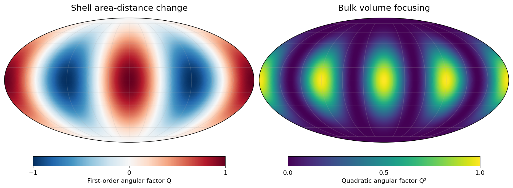

# What happens to the light beam in the extra direction?

A light beam on the modeled shell has two directions across its image. In the surrounding five-dimensional spacetime, a beam has a third. **Where the shell image expands at first order, a pencil of rays tilted slightly off the shell narrows in the extra direction.** The two changes cancel exactly in the full beam volume at that order. At second order the volume decreases in a calculable angular pattern. These predictions use the registered disturbance, the same receiving observer and the same fixed affine length as the earlier shell optical calculation. [Zenodo edition](https://doi.org/10.5281/zenodo.24353557) · [Previous shell measurement](../HDBLAST_FINITE_LIGHT_CONES_20261118/DERIVATION.md)

A separate test uses the spatial volume of the entire shell. A closed universe with only a cosmological constant and separately conserved radiation can match the shell’s initial quiet interval only if its radiation density vanishes. [Proper-volume test and scope](ORIGIN.md)

## What the shell predicts

At the specified observer the angular perturbation is $Q=v_1^2-v_2^2$. Here $v$ is a unit direction in the observer's sky along the shell. The boundary carries pure tension, so its extrinsic curvature is proportional to its metric. An initially tangent ray follows the shell as a bulk null geodesic as well. Let $D_A$ be the intrinsic area distance, $j$ the inward separation per unit infinitesimal inclination, and $V=(D_A^2j)^{1/3}$ the full optical volume radius before caustics. On the reference ray $D_A=j=V=L$ at the chosen affine length $L$. A prime with respect to the disturbance in the table means a derivative in its signed canonical amplitude $\epsilon$ at zero. [Exact splitting and one-sided launch geometry](EMBEDDING.md)

| Reading | Model prediction |
| --- | --- |
| Change of shell area distance and inward separation | $\delta j/L=-2\,\delta D_A/L$ pointwise at fixed affine length. For the central positive-axis ray the fractional inward-separation derivative lies between $-1.153\times10^{-24}$ and $-1.041\times10^{-24}$. |
| Bulk volume radius near a tangent ray | $1-V/L=K\epsilon^2Q^2+o(\epsilon^2)$ with $K>8.57864\times10^{-25}$. This number is a **lower bound** on a coefficient, not a measured amplitude. |
| Directional contrast with a small inward aperture | At leading order the difference of the axial and diagonal cap-pair deficits equals **999/1000** of the background-subtracted mean deficit over all tangent directions with the same inward aperture. Each cap occupies one tenth of the tangent-direction sky. |

The colors show angular factors normalized to unit maximum. The left pattern changes sign when the two quadrupole axes are exchanged. The right pattern is positive along both axes and vanishes to quadratic order along their nodal directions. The two maps have different perturbation orders and physical scales. The number 999/1000 comes from integrating this pattern over the chosen cap sizes. The comparison uses a family of apertures that shrinks at least as fast as the disturbance, with exact solid-angle normalization. [Inward separation and opening rate](FIRST_ORDER.md) · [Aperture and angular derivation](APERTURE.md)

## Why the cancellation is testable in the model

The five-dimensional Ricci contraction along a null ray is the square of the scalar derivative along that ray. The background scalar is constant along the wall. Its focusing effect therefore starts quadratically on a tangent ray. At linear order an increase in the two shell screen directions must be balanced by the third. At quadratic order both the scalar flux and the distortion of the beam shape, called shear, contribute nonnegative focusing. The flux lower bound uses all 64 certified waveform cells on the affine experiment's clock interval. A second bound uses 62 interior pairs and avoids differentiating tabulated scalar values. [Bulk shear calculation](QUADRATIC_FOCUSING.md) · [Scalar flux bounds](FLUX.md)

A wall-confined camera receives the two tangential image directions. Accessing the third would require a bulk-propagating probe or a specified coupling with a separately calibrated readout. The local geometry confines rays launched exactly tangent and admits a small inward angular interval through the tested segment. It provides no distant return path or arrival-time advance in the perturbed spacetime. A four-dimensional effective theory can also reproduce wall observables. The calculation supplies a conditional bulk propagation test and leaves the cosmological origin of the Big Bang open. [What a detector could measure](ACCESS.md) · [Prior literature](LITERATURE.md) · [Project and archive review](PORTFOLIO.md)

## Reproduce

Use Python 3.12 from this directory, either in the repository or the extracted ZIP. The exact arithmetic uses the standard library. NumPy and Matplotlib are needed only to redraw the figure.

~~~sh
sha256sum -c SHA256SUMS
python -I -B reproduce.py
python -I -B -O reproduce.py
~~~

The archive includes the earlier finite-affine study, joint-curvature inputs and the cited project source files. [Source inventory](SOURCES.json)
