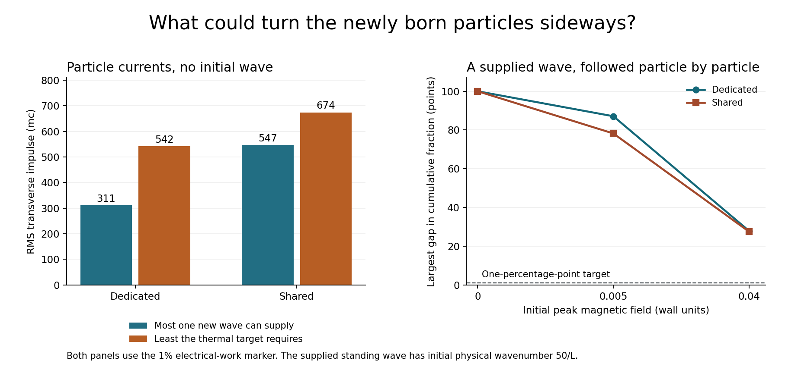

# Can the five-dimensional pulse turn the particles on the wall?

The previous HDblast calculation tracked when the first charged particles appeared as the simulated wall expanded. A thermal gas would have many more particles moving sideways than those births alone supplied. This study tests whether the electromagnetic signal from the surrounding space and the particles' own fields can close that gap. The comparison uses the recorded mean expansion, electric and magnetic guide fields, production histories, two elastic-interaction models and the earlier thermal temperatures. The measurements below are from a simulation.

**Main result.** The wave still arriving from the higher-dimensional space during early particle production is too weak to produce the assumed sideways spread if an extra transverse component is limited to the strength of that measured tail. Under the specified boundary coupling, an incoming component with the tail’s time dependence needs roughly two to three hundred times its amplitude. A transverse field established by the earlier, stronger part of the pulse could act sooner. The benchmark has yet to demonstrate how such a field forms and survives. [Direct measurement and source bound](bulk/README.md)

## When does the signal arrive?

The inward-moving axial signal reached its maximum before the charged particles appeared. During the short interval from the start of births until 1% of the total electrical work had been exchanged, its RMS amplitude was about 0.000144 in wall units. Work here counts electrical energy transferred between the wall field and daughters in either direction. A 1% work marker denotes an instant during the particular run.

We grant an additional incoming transverse wave the same boundary coupling as the axial wave, the most favorable direction and the help of any available daughter currents. The wall patch starts with zero transverse perturbation and uniform number density. We count particles below each possible value of the sideways momentum. To bring every count within one percentage point of the thermal prediction, an incoming source following the time profile of the measured axial tail needs at least about 323 times its amplitude for species with separate interactions, or 196 times for a shared interaction. The coarser runs give about 320 and 193. These numbers test the late-arriving signal. A field capable of surviving from the earlier strong pulse is an alternative whose generation and storage need to be calculated. [Boundary equation, inequalities and recovered waveform](bulk/README.md)

| Question | Separate interactions | Shared interaction |
|---|---:|---:|
| Lower bound on the RMS amplitude of any additional incoming waveform by 1% work, on the finer grid | 0.0423 | 0.0255 |
| Required local density relative to its mean in some population, with no initial or incoming perturbation, by 0.1% work | Greater than 15 | Greater than 14 |
| Same density test, by 1% work | Greater than 1.43 | Greater than 1.29 |
| Gap between the thermal and computed cumulative sideways-momentum counts in a nonlinear test with an imposed wave, at 1% work | 27.5 percentage points | 27.3 percentage points |

The density calculation permits electromagnetic waves in every spatial direction and gives the particles every current their number and velocities allow. The estimated collision ceiling also rises with local density. The bounds measure the largest concentration anywhere during that interval. Reaching a density threshold is necessary and leaves the evolution that produces it open. At 5% work the same argument no longer excludes spatially uniform matter. [Density bound and field assumptions](global/README.md)

The last row follows particles accelerated by an added standing magnetic wave. Its initial peak amplitude was 0.04, approximately 19% of the main electric field in the model units. Despite picking up enough sideways momentum to cross the earlier minimum impulse target, the particle counts did not follow the thermal distribution. In the shared case, for example, the refined result still differs by 27.3 percentage points at one momentum threshold. [Particle dynamics and exact plane-wave check](particles/README.md)

## What can generate a perturbation?

- The birth-time analysis bounds the transverse force needed for daughters produced near the comparison time. Requiring perfect agreement with a thermal distribution is much more demanding than allowing a one-percentage-point discrepancy. [Birth and force budgets](history/RESULTS.md)
- The instantaneous dispersion calculation distinguishes the instability of an idealized stationary beam from amplification during a pulse with continual injection and axial acceleration. [Cold-stream modes](dispersion/FROZEN.md) · [Finite-time amplification](modes/RESULTS.md)
- One initially empty electromagnetic Fourier pair driven solely by the daughter current has insufficient time to supply the required RMS impulse under the archived collision bound. [Current limit](causal/CURRENT_CAP.md)
- The source-ensemble fluctuations of independent pair births are too small in the tested finite periodic volume and wave-number band. The finite-pitch calculation includes all 17,990,702,160 wavevector pairs up to the stated cutoff. [Noise-source assumption and impulse bounds](modes/NOISE_BOUND.md)
- The age ordering of the particles gives a separate lower bound on the time-integrated squared field amplitude. [Field exposure](energy/README.md)



## Reproduce the calculations

Use Python 3.12, NumPy 2.3.5, SciPy 1.17.0 and a C++17 compiler available as `g++`. From this directory run the following commands. The first command authenticates the capsule with the Python standard library. The second rebuilds four full five-dimensional wall histories, compares their compact forms, reruns twelve numerical products and checks the physical conclusions. Supply a new or empty output directory outside the capsule and a location with several gigabytes available for temporary files.

```sh
python -I -B -S study.py
python -I -B study.py --verify --jobs 2 --output-dir ../transverse-results
```

The folder `parent` includes the exact preceding source files required for this run and their old manifest. The outer `SHA256SUMS` fingerprints the full study. The compact histories permit working directly with the stored source functions without retaining the full traces. The figure can be regenerated with [figure.py](figure.py). [Relevant research and its limits](SOURCES.md) · [Previous study](https://doi.org/10.5281/zenodo.24409605) · [Question recorded before running these tests](https://github.com/maldonado-research/HDblast/issues/157#issuecomment-7060208001)

Within this model the measured tail and weakly structured matter leave a quantified early deficit. A coupled calculation of the incoming perturbation before birth, the stored field at birth and its effect on subsequent production would test whether an earlier signal can supply it. Establishing that any such mechanism occurred in our universe would require evidence beyond these calculations.
