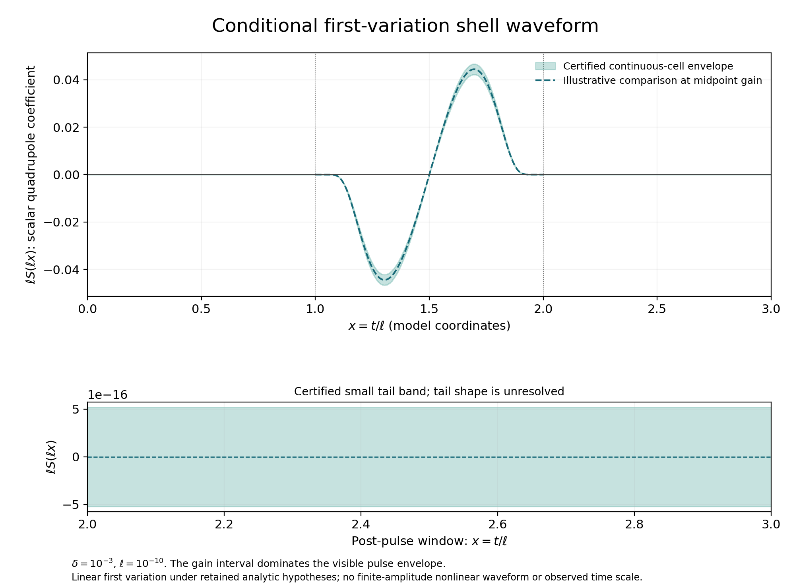

# HDBLAST: a resolved first-variation shell waveform

15 October 2026 UTC. Conditional mathematical checkpoint.

For the same retained background and narrow aligned quadrupole as the preceding
checkpoint, the physical shell scalar's first variation now has a continuous
waveform enclosure. With rescaled time x=t/ell, ell=10^-10 and H=ell D(ell x),

\[
\left|H(x)-\left[Q'(x)+\ell e^{-\ell x}Q(x)\right]\right|
 <1.0000004\times10^{-7},\qquad 0\le x\le3.
\]

The first variation is exactly zero before x=1. On 2<=x<=3 its scaled
derivative trace has absolute value below 4.752e-14; the tail's shape is
unresolved. The physical scalar coefficient has a negative, authenticated
gain, so its pulse orientation reverses that of H. All 4,098 exported time
cells enclose whole intervals, including the gaps between any displayed points.



The same state and normalization also give the sharper strict bound

\[
6.06\times10^{15}<\mathcal C<7.44\times10^{15},\qquad
\mathcal R_\varepsilon=\varepsilon^2\mathcal C+o(\varepsilon^2).
\]

Read [the primary proof](UNIFORM_FIRST_VARIATION_WAVEFORM.md) for the physical
proper-time definition, gain, initial data and retained analytic hypotheses.
This is a first variation in model coordinates. It supplies no finite-amplitude
nonlinear waveform, effective epsilon interval, observed time scale or evidence
for a higher-dimensional Big Bang origin. Internal AI-assisted review and finite
arithmetic checks do not constitute external peer review, certified novelty or
a formal verification of the analytic PDE proof.

## Reproduce

Use Python 3.12 and the pinned symbolic dependency in `requirements.txt`.
Obtain the external manifest SHA256 from the dated publication receipt or
repository workflow, and keep the extracted capsule directory name.

```sh
python -I -S -B verify_manifest.py --expected EXTERNAL_MANIFEST_SHA256
python -I -B -m pip install --only-binary=:all: -r requirements.txt
python -I -B reproduce.py --manifest-sha256 EXTERNAL_MANIFEST_SHA256 --output-dir /tmp/hdblast-waveform-fresh
```

Choose a new output directory outside the capsule. The runner authenticates
the entire source inventory before execution, then replays normal and optimized
Python in separate copied workspaces. It compares the complete generated JSON
and CSV bytes, and requires deliberate wrong formulas to fail for their named
reasons. Its receipt records actual process and finite-check counts. Those
counts do not measure analytic theorems proved by a computer.

`waveform_intervals.py` uses outward dyadic interval arithmetic and rational
exponential bounds, including flat support endpoints. `compute_waveform.py`
exports continuous cells and integrates their interval ranges; it uses no
time-stepping PDE solver or sampled quadrature assumption. `check_waveform.py`
checks arithmetic, endpoint handling, signs, error constants and response
scaling. The analytic observation estimate controls the shell derivative
directly and retains positive boundary inertia.

Plotting is optional and excluded from the scientific replay dependency.
`plot_waveform.py` requires Matplotlib 3.10.8; its floating display calculations
do not enter any certified decision. Static PNG and SVG figures are included.

## Independent derivations and provenance

- [Sol proof](sol/UNIFORM_WAVEFORM_CERTIFICATE.md) and exact-rational checks.
- [Astra proof](astra/UNIFORM_POINTWISE_WAVEFORM.md) and [peak analysis](astra/peak_analysis/peak_analysis.txt). Actual global-extremum windows apply to H; comparator uniqueness does not establish uniqueness for the actual solution.
- [Independent characteristic proof](referee/INDEPENDENT_UNIFORM_TRACE_BOUND.md), reconstruction of every exported cell, and [critical acceptance](referee/FINAL_UNIFORM_WAVEFORM_ACCEPTANCE.md).
- [Correlated physical gain audit](archive/PHYSICAL_GAIN_AUDIT.md), with minimal authenticated branch references. Reference-only archived programs are not executed.
- [Focused primary-literature comparison](literature/WAVEFORM_PRIMARY_LITERATURE.md), with a bounded search receipt. Raw retrieved paper bodies are excluded.
- `inputs/previous/` preserves four prior analytic inputs verbatim with source pins to the preceding merged checkpoint.

The next step is a wider, practically chosen state with a validated background
tube and continuous coupled characteristic/shell reconstruction. The central
remaining target is an effective nonlinear remainder bound and a nonzero
admissible epsilon interval. That would connect a first variation to a controlled
finite-amplitude prediction while quantifying the localized inverse, support,
gauge and evolution assumptions. This narrow-state waveform supplies a benchmark
for that implementation.
No new Zenodo version or APS submission accompanies this checkpoint.
